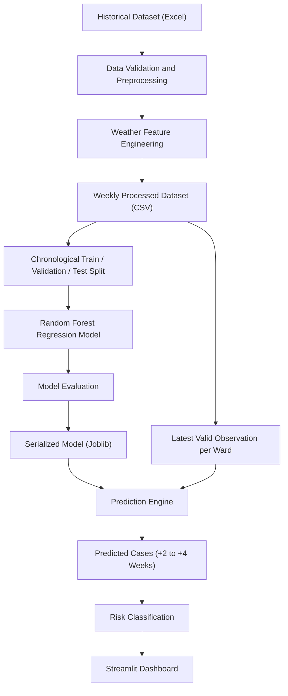

# Dengue-Early-Warning — System Architecture

## 1. System Overview

DengueGuard AI is an AI-powered urban dengue early-warning prototype. It uses historical ward-level dengue and weather observations to estimate cumulative dengue cases across weeks +2, +3 and +4.

The system combines weather feature engineering, ward-level vulnerability indicators, a machine learning prediction model, and an interactive Streamlit dashboard.

## 2. System Architecture and Data Flow

### Data Processing

The system reads the original Excel dataset and validates required columns, dates, numeric values, missing values, and duplicate ward-date records.

The preprocessing pipeline sorts observations chronologically within each ward and generates:

- Weekly rainfall lags (1–4 weeks).
- Rolling rainfall sums (2, 3 and 4 weeks).
- Four-week average temperature.
- Four-week average relative humidity.
- Seasonal month features (sine and cosine transformations).
- Ward-level vulnerability indicators, including population density, waterlogging risk and sanitation score.

The processed dataset is stored at `data/processed/weekly_features.csv`.

Missing values created during lag and rolling-window calculations are retained and excluded where required for model training and prediction.

## 3. Prediction Target and Model

### Prediction Target

The model predicts cumulative dengue cases across three future weeks:

`target_cases_2to4w = cases(+2) + cases(+3) + cases(+4)`

Current dengue case counts are excluded from the model input features to avoid directly using the outcome being predicted.

### Model Selection

The system uses a Scikit-learn Random Forest Regressor.

Model configuration:

- Estimators: 300
- Maximum depth: 18
- Minimum samples per leaf: 2
- Random state: 42
- Parallel processing: enabled

The model uses numerical preprocessing with median imputation and categorical preprocessing with most-frequent imputation and one-hot encoding.

Random Forest was selected as the prototype regression model because it can learn nonlinear relationships between weather conditions, ward characteristics and dengue outcomes.

## 4. Chronological Validation Strategy

To reduce temporal leakage, observations are separated chronologically rather than randomly.

| Dataset | Date range |
|---|---|
| Training | Up to 27 November 2023 |
| Validation | 1 January – 25 November 2024 |
| Testing | 6 January – 24 November 2025 |

Temporal gaps are used between the periods to reduce overlap between future target windows.

The model is evaluated using Mean Absolute Error (MAE) and Root Mean Squared Error (RMSE).

Recorded evaluation results:

| Metric | Validation | Test |
|---|---:|---:|
| MAE | 2.432 | 3.359 |
| RMSE | 4.451 | 6.102 |

These are retrospective evaluation results on the available dataset, not evidence of validated real-world outbreak detection.

## 5. Risk Classification

Predicted cumulative cases are assigned to four prototype risk categories using thresholds derived from training-target quantiles.

| Risk category | Predicted cases |
|---|---:|
| Low | Less than 1 |
| Medium | 1 to less than 14 |
| High | 14 to less than 28 |
| Critical | 28 or above |

These thresholds are experimental model thresholds and are not officially validated public-health alert levels.

## 6. Dashboard and Deployment

The interactive dashboard is developed using Streamlit and Plotly.

It provides:

- City and ward filtering.
- Historical dengue case trends.
- Weather trend visualization.
- Ward-level predicted dengue cases.
- Top 10 ward-level prediction ranking.
- Ward comparison chart.
- Risk-category distribution.
- Model performance metrics.

The trained model is serialized using Joblib and loaded through Streamlit resource caching. Dataset and prediction loading use Streamlit data caching to reduce repeated computation.

## 7. Efficiency and Cost Controls

The application uses a locally stored serialized model instead of retraining during dashboard execution.

- Model inference runs locally.
- Joblib serialization with compression reduces model storage size.
- Streamlit caching avoids unnecessary repeated data loading and model loading.
- No external LLM API is required for the prediction pipeline.
- No external prediction API is required by the current prototype.

## 8. Limitations

- Predictions are based on the latest available historical observations in the supplied dataset.
- The current dataset ends in December 2025; therefore, dashboard predictions are not live forecasts for 2026.
- Risk thresholds are experimental and require public-health validation.
- Model performance may vary across cities, wards and seasons.
- The prototype should support further investigation and should not replace official public-health decisions.

## 9. Technology Stack

- Python
- Pandas and NumPy
- Scikit-learn
- Joblib
- Streamlit
- Plotly
- OpenPyXL
